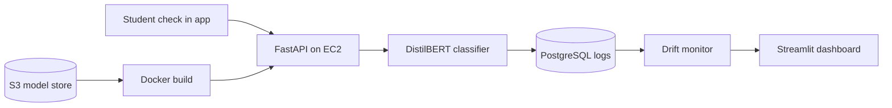
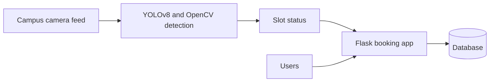
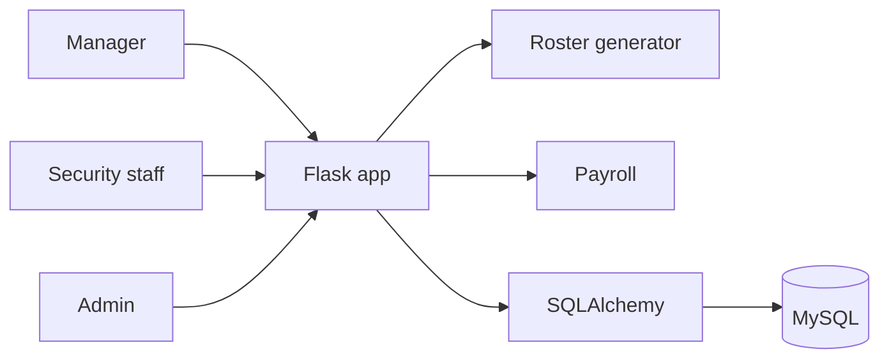

<h1 align="center">Hi, I'm Piyush Kasle</h1>

  Backend and full stack engineer · MS Software Engineering, Florida Institute of Technology

  

  I build backend and full stack systems, with a lean toward the infrastructure around ML: serving, deployment and monitoring.

  
  

  <picture>
    <source media="(prefers-color-scheme: dark)" srcset="https://skillicons.dev/icons?i=python,java,js,nodejs,express,fastapi,flask,react,postgres,mysql,redis,docker,aws,githubactions,linux,pytorch,git&theme=dark&perline=9" />
    <source media="(prefers-color-scheme: light)" srcset="https://skillicons.dev/icons?i=python,java,js,nodejs,express,fastapi,flask,react,postgres,mysql,redis,docker,aws,githubactions,linux,pytorch,git&theme=light&perline=9" />
    
  </picture>

---

## Projects

### [Mental Health MLOps](https://github.com/HumbleFool02/mental-health-mlops)

ML side of a university health center's student check in app: a DistilBERT classifier served with FastAPI on AWS, with drift monitoring and a dashboard.

<b>Architecture</b>

### [Smart Parking Management System](https://github.com/HumbleFool02/Parking-Management-Sytem)

Campus smart parking: YOLOv8 slot detection on camera footage plus a Flask booking app.

<b>Architecture</b>

### [Security Shift Manager](https://github.com/HumbleFool02/security-shift-manager)

Three role Flask app for scheduling a campus security workforce: fair roster generation, leave workflow and payroll.

<b>Architecture</b>

